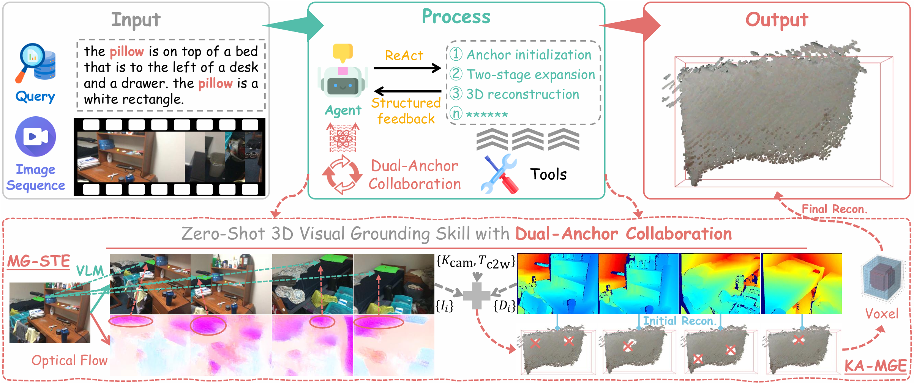

<h2 align="center"> <a href="https://arxiv.org/abs/2611.25722">DACA: Dual-Anchor Collaborative Agent for Zero-Shot 3D Visual Grounding</a></h2>

<h5 align="center">

[Jiaming Liu](https://scholar.google.com/citations?user=eQERdsAAAAAJ) <sup>1</sup>, [Linghe Kong](https://www.cs.sjtu.edu.cn/~linghe.kong/) <sup>1,✉</sup> , [Guixu Zhang](https://zyxy.ecnu.edu.cn/54/10/c36124a676880/page.htm) <sup>2</sup>, [Huaxi Huang](https://agentichhx.xin/) <sup>3</sup>

<sup>1</sup> Shanghai Jiao Tong University · <sup>2</sup> East China Normal University · <sup>3</sup> Shanghai Artificial Intelligence Laboratory

(​✉️​) Corresponding author

[](https://arxiv.org/pdf/2611.25722)

</h5>

<div align="center">
  
</div><br/>

## 🛠️ Install
1. Clone this repository and navigate to folder
```bash
git clone https://github.com/liujia99/DACA
cd DACA
```

2. Install Package
```Shell
conda create -n daca python=3.10
conda activate daca
pip install -r requirements.txt
pip install flash-attn==2.7.3 --no-build-isolation 
# if flash-attn is not avaliable, modify the attn_implementation in agent/client.py from "flash_attention_2" to "eager"
# or run: pip install https://github.com/Dao-AILab/flash-attention/releases/download/v2.7.3/flash_attn-2.7.3+cu12torch2.4cxx11abiFALSE-cp312-cp312-linux_x86_64.whl
```

## 🤗 Prepare Models
Set your own `weight_path` to storage the pretrained weights. The folder should be organized as follows: 
```
├── DACA
│   └── agent
│   └── main.py
│   └── ...
├── weight_path
│   └── Qwen3-VL-32B-Instruct
│   └── sam3
```
Download the pretrained weights [🤗Qwen3-VL-32B-Instruct](https://huggingface.co/Qwen/Qwen3-VL-32B-Instruct) and [🤗SAM3](https://huggingface.co/facebook/sam3) in your own `weight_path`. 


##  🗂️ Prepare Datasets
Follow [TAB](https://github.com/WHB139426/TAB-Agent.git), the [ScanRef](https://github.com/daveredrum/ScanRefer) and [Nr3D](https://github.com/referit3d/referit3d) datasets along with the refined annotations are provided on Hugging Face: [[🤗WHB139426/Scannet](https://huggingface.co/datasets/WHB139426/Scannet)]. Please download the required files and extract `scannet-dataset.zip` and `scannet-frames.zip` into your designated `data_path`. After downloading and unzipping, your workspace should be organized as follows:
```text
├── DACA/                            
│   ├── agent/
│   ├── main.py
│   └── ...
├── weight_path/                          
│   ├── Qwen3-VL-32B-Instruct/
│   └── sam3/
└── data_path/                            
    ├── referit3d/
    │   └── nr3d_val_250_refined.json
    ├── scanref/
    │   └── scanref_val_250_refined.json
    ├── scannet-dataset/                  # Unzipped from scannet-dataset.zip
    │   ├── scene0000_00/
    │   │   ├── scene0000_00_vh_clean_2.ply
    │   │   ├── scene0000_00_vh_clean_2.labels.ply
    │   │   ├── scene0000_00_vh_clean_2.0.010000.segs.json
    │   │   ├── scene0000_00.aggregation.json
    │   │   └── scene0000_00.txt
    │   ├── scene0000_01/
    │   └── ...
    └── scannet-frames/                   # Unzipped from scannet-frames.zip
        ├── scene0000_00/
        │   ├── 00000.jpg
        │   ├── 00000.png 
        │   ├── 00000.txt
        │   └── ...
        ├── scene0000_01/
        └── ...
```

## 🚀 Qucik Start
We give a brief example to run the example code. We recommend a single GPU with 80GB memeroy for **Qwen3-VL-32B-Instruct** inference.

```Shell
CUDA_VISIBLE_DEVICES=<GPU> python main.py --client_id <your_client_path> --sam_path <your_sam_path>
```
4. You can observe the execution trace in `3dagent_cache/chat_history.json`

## 💡 Evaluation
To evaluate the model on the validation sets, please follow these steps:
1. Execute the evaluation script. You can easily control the number of GPUs used for parallel inference by modifying `CUDA_VISIBLE_DEVICES` within the script.
```bash
CUDA_VISIBLE_DEVICES=<GPU> python eval.py 
```
2. Once the inference is complete, run the corresponding Python script to calculate the final metrics for your target dataset:
```bash
# For ScanRef results
python result_scanref.py

# For Nr3D results 
python result_nr3d.py
```

## 🙏‍ Acknowledgment
We thank the authors of [TAB](https://github.com/WHB139426/TAB-Agent.git) for their valuable open‑source contributions, which greatly benefit this work.

## ✏️ Citation
If you find our paper and code useful in your research, please consider giving a star ⭐ and citation:
```BibTeX
@article{liu2026daca,
  title={DACA: Dual-Anchor Collaborative Agent for Zero-Shot 3D Visual Grounding},
  author={Liu, Jiaming and Kong, Linghe and Zhang, Guixu and Huang, Huaxi},
  journal={arXiv preprint arXiv:2611.25722},
  year={2026}
}
```
